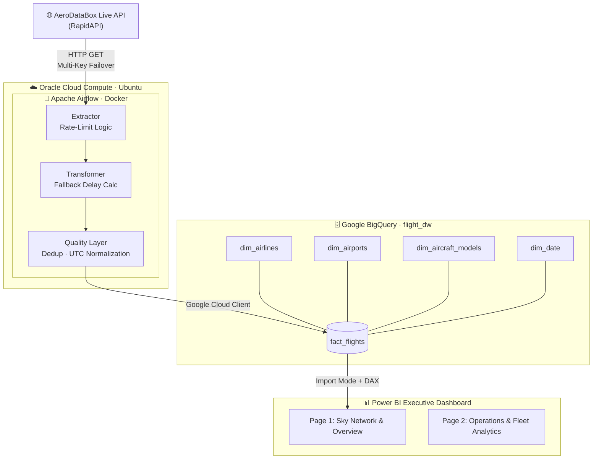
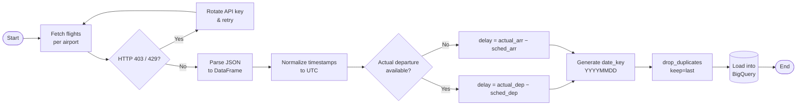
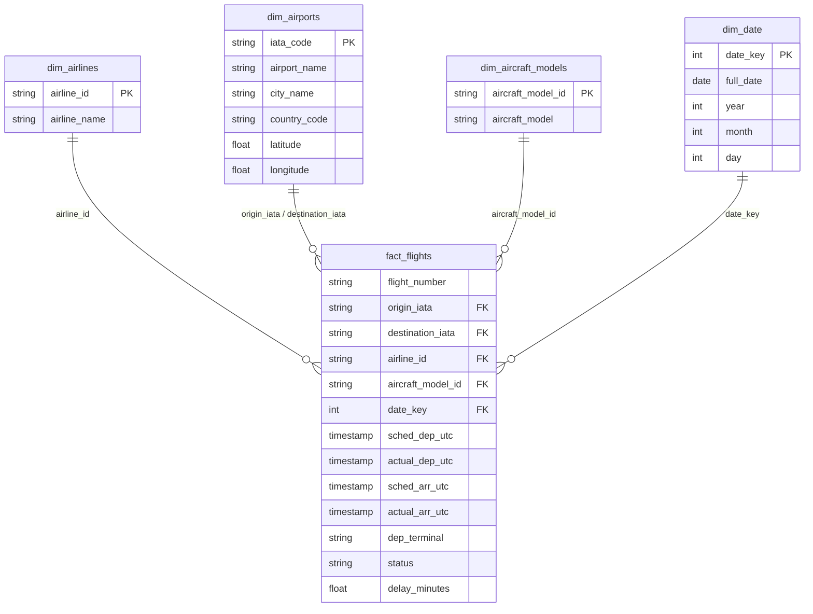
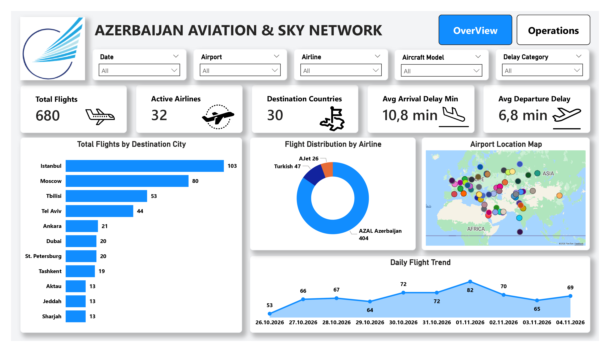
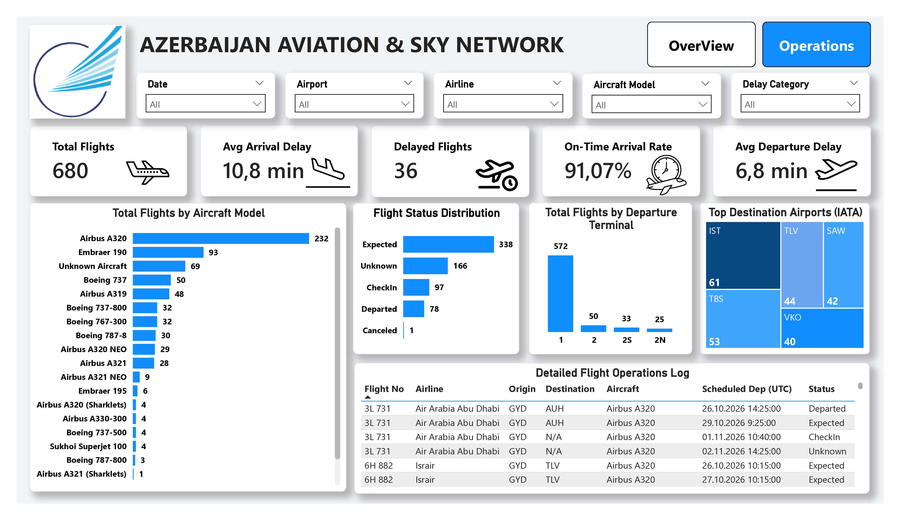

<div align="left">

# ✈️ Azerbaijan Aviation & Sky Network

### Automated Real-Time Flight Data Engineering & Analytics Pipeline

*From live flight telemetry to executive-grade insights: Airflow → BigQuery → Power BI*


[Overview](#-overview) •
[Architecture](#-system-architecture) •
[Data Model](#-data-warehouse-star-schema) •
[Dashboard](#-power-bi-dashboard) •
[Insights](#-key-analytical-findings) •
[Quick Start](#-quick-start) •
[Roadmap](#-roadmap)

</div>

---

## 📑 Table of Contents

- [Overview](#-overview)
- [Executive Summary & Key Metrics](#-executive-summary--key-metrics)
- [System Architecture](#-system-architecture)
- [Pipeline Logic (ETL)](#-pipeline-logic-etl)
- [Key Engineering Features](#-key-engineering-features)
- [Data Warehouse (Star Schema)](#-data-warehouse-star-schema)
- [Power BI Dashboard](#-power-bi-dashboard)
- [Key Analytical Findings](#-key-analytical-findings)
- [Tech Stack](#-tech-stack)
- [Quick Start](#-quick-start)
- [Configuration](#-configuration)
- [Repository Structure](#-repository-structure)
- [Engineering Challenges & Solutions](#-engineering-challenges--solutions)
- [Roadmap](#-roadmap)
- [Troubleshooting](#-troubleshooting)
- [Security](#-security)
- [Author](#-author)

---

## 🎯 Overview

An enterprise-grade, automated data engineering and business intelligence solution that **extracts, transforms, warehouses and analyzes real-time flight telemetry** across Azerbaijani airports:

| Code | Airport |
|:----:|---------|
| **GYD** | Heydar Aliyev International Airport (Baku) |
| **NAJ** | Nakhchivan International Airport |
| **GNJ** | Ganja International Airport |
| **LLK** | Lankaran International Airport |
| **FZL** | Fuzuli International Airport |

A containerized **Apache Airflow** DAG runs on **Oracle Cloud Infrastructure (OCI)**, ingests live flight feeds from the AeroDataBox API, cleans and normalizes raw JSON payloads with **Python / Pandas**, models a **Star Schema Data Warehouse in Google BigQuery**, and powers an executive **Power BI** report with custom DAX measures.

---

## 📌 Executive Summary & Key Metrics

The pipeline continuously monitors flight operations, evaluating carrier performance, delays, terminal utilization and fleet assignment dynamics.

| Metric | Value |
|--------|------:|
| ✈️ Total Flights Processed | **680+** |
| 🏢 Active Airlines Monitored | **32 carriers** |
| 🌍 Destination Reach | **30 countries / 37+ cities** |
| ⏱️ On-Time Arrival Rate | **91.07%** |
| 🛬 Average Arrival Delay | **10.8 min** |
| 🛫 Average Departure Delay | **6.8 min** |

---

## 🏗️ System Architecture



---

## ⚙️ Pipeline Logic (ETL)



---

## 🌟 Key Engineering Features

<table>
<tr>
<td width="50%" valign="top">

### 🔑 Multi-Key API Failover
Dynamic API key rotation handles HTTP `403` and `429` rate-limit responses gracefully, keeping the pipeline running without failures.

</td>
<td width="50%" valign="top">

### 🧮 Dynamic Fallback Delay Computation
Prioritizes actual departure timestamps (`Actual − Scheduled`) and falls back to arrival timestamp deltas when departure telemetry is pending or missing from radar feeds.

</td>
</tr>
<tr>
<td width="50%" valign="top">

### 🧹 Data Quality & Deduplication
Applies the following logic to make incremental re-runs idempotent and prevent duplicate records in BigQuery:

```python
df.drop_duplicates(
    subset=["flight_number", "date_key", "origin_iata"],
    keep="last",
)
```

</td>
<td width="50%" valign="top">

### 🕒 Timezone & Surrogate Key Standardization
All incoming dates are converted to UTC `TIMESTAMP`, and integer surrogate date keys (`YYYYMMDD`) are generated for dimensional slicing.

</td>
</tr>
</table>

---

## 🗄️ Data Warehouse (Star Schema)

The BigQuery warehouse (`flight_dw`) is designed as a clean **Star Schema** optimized for OLAP-style analytical queries.



<details>
<summary><b>📖 Data Dictionary (click to expand)</b></summary>

<br/>

| Table | Column | Description |
|-------|--------|-------------|
| `fact_flights` | `flight_number` | Flight identifier (e.g. carrier code + number) |
| `fact_flights` | `origin_iata` / `destination_iata` | FK → `dim_airports.iata_code` |
| `fact_flights` | `airline_id` | FK → `dim_airlines` |
| `fact_flights` | `aircraft_model_id` | FK → `dim_aircraft_models` |
| `fact_flights` | `date_key` | FK → `dim_date` (`YYYYMMDD` surrogate key) |
| `fact_flights` | `sched_dep_utc`, `actual_dep_utc` | Scheduled / actual departure (UTC) |
| `fact_flights` | `sched_arr_utc`, `actual_arr_utc` | Scheduled / actual arrival (UTC) |
| `fact_flights` | `dep_terminal` | Departure terminal |
| `fact_flights` | `status` | Flight status reported by the feed |
| `fact_flights` | `delay_minutes` | Computed delay (departure-first, arrival fallback) |
| `dim_airports` | `iata_code` | Primary key |
| `dim_airports` | `airport_name`, `city_name`, `country_code` | Descriptive attributes |
| `dim_airports` | `latitude`, `longitude` | Used for the Power BI route map |
| `dim_date` | `date_key`, `full_date`, `year`, `month`, `day` | Calendar dimension |

</details>

---

## 📊 Power BI Dashboard

The report features custom DAX measures, dynamic slicers and cross-filtering across **2 interactive pages**.

### 📄 Page 1 · Overview & Network Coverage



- **Top KPI Strip:** Total Flights (**680**), Active Airlines (**32**), Destinations (**30** countries), Avg Arrival Delay (**10.8 min**), Avg Departure Delay (**6.8 min**).
- **Destination Ranking:** Top destination cities led by Istanbul (**103** flights) and Moscow (**80** flights).
- **Global Route Map:** Geographic view of international destinations served from Azerbaijani airports.
- **Daily Flight Trend:** Time-series of daily volume, fluctuating between **53 and 82** flights per day.

### 📄 Page 2 · Operations & Fleet Analytics



- **Operational Performance:** Delayed Flights (**36**) alongside an On-Time Arrival Rate of **91.07%**.
- **Fleet Breakdown:** Operations by aircraft model, dominated by the narrow-body Airbus A320 (**232** flights) and Embraer 190 (**93** flights).
- **Terminal Operations:** Load balance across terminals, with Terminal 1 handling over **84%** of departures (**572** flights).
- **Detailed Operations Log:** Tabular log with real-time flight status, callsigns, and schedules.

<details>
<summary><b>🧠 Example DAX Measures (illustrative)</b></summary>

```dax
Total Flights = COUNTROWS ( fact_flights )

Active Airlines = DISTINCTCOUNT ( fact_flights[airline_id] )

Avg Delay (min) = AVERAGE ( fact_flights[delay_minutes] )

Delayed Flights =
CALCULATE (
    COUNTROWS ( fact_flights ),
    fact_flights[delay_minutes] > 15
)

On-Time Rate % =
DIVIDE (
    [Total Flights] - [Delayed Flights],
    [Total Flights]
)
```

> The delay threshold and exact measure definitions in the `.pbix` file may differ; the snippet above shows the modeling approach.

</details>

---

## 🔍 Key Analytical Findings

> Insights derived from the SQL queries in [`sql/analytical_queries.sql`](sql/analytical_queries.sql).

| # | Finding | Detail |
|:-:|---------|--------|
| 1 | **Peak Departure Waves** | Two operational peaks: **Evening 16:00–18:00 UTC (28.85% of traffic)** and **Morning 03:00–05:00 UTC (20.33% of traffic)**. |
| 2 | **Hub vs. Point-to-Point** | Flag carrier **AZAL** runs a classic **Hub & Spoke** network (37 cities, 22 countries), while foreign operators fly strictly **Point-to-Point** routes to their own hubs. |
| 3 | **Route & Fleet Matching** | Short-haul regional routes (e.g. Tbilisi) rely on regional jets (**Embraer 190, 83% share**); high-density routes (Moscow, Tel Aviv) deploy wide-bodies (**Boeing 767-300**, **Boeing 787-8 Dreamliner**). |

<details>
<summary><b>🧾 Sample query: departure peaks by hour (illustrative)</b></summary>

```sql
SELECT
  EXTRACT(HOUR FROM sched_dep_utc)                         AS dep_hour_utc,
  COUNT(*)                                                 AS flights,
  ROUND(100 * COUNT(*) / SUM(COUNT(*)) OVER (), 2)         AS share_pct
FROM `flight_dw.fact_flights`
GROUP BY dep_hour_utc
ORDER BY flights DESC;
```

</details>

---

## 🧰 Tech Stack

| Layer | Technology |
|-------|------------|
| **Data Source** | AeroDataBox API (RapidAPI) |
| **Orchestration** | Apache Airflow 2.7 (Docker) |
| **Infrastructure** | Oracle Cloud Infrastructure (Ubuntu Compute) |
| **Transformation** | Python 3.10, Pandas |
| **Data Warehouse** | Google BigQuery (Star Schema) |
| **Analytics** | SQL (BigQuery Standard SQL) |
| **BI & Visualization** | Power BI, DAX |
| **Containerization** | Docker, Docker Compose |

---

## 🚀 Quick Start

### Prerequisites

- 🐳 Docker & Docker Compose
- ☁️ Google Cloud Platform account with BigQuery enabled
- 🔑 AeroDataBox API key(s) from RapidAPI
- 🐍 Python 3.10+

### Installation

**1️⃣ Clone the repository**

```bash
git clone https://github.com/NihatRz/azerbaijan-aviation-pipeline.git
cd azerbaijan-aviation-pipeline
```

**2️⃣ Configure the GCP service account**

```bash
mkdir -p config
cp /path/to/your-gcp-key.json config/gcp_key.json
```

**3️⃣ Deploy the containerized Airflow stack**

```bash
docker-compose up -d
```

**4️⃣ Initialize the BigQuery schema**

Run the DDL script in the Google Cloud Console SQL Editor, or via the `bq` CLI:

```bash
bq query --use_legacy_sql=false < sql/schema_setup.sql
```

**5️⃣ Trigger the Airflow DAG**

Open the Airflow UI at **http://localhost:8080** (default credentials: `airflow` / `airflow`) and enable the `flight_etl_pipeline` DAG.

---

## 🔧 Configuration

| Item | Location | Description |
|------|----------|-------------|
| GCP credentials | `config/gcp_key.json` | Service account key with BigQuery write access |
| API keys | `.env` / Airflow Variables | One or more RapidAPI keys used for rotation on `403` / `429` |
| Airports | DAG source | Monitored IATA codes: `GYD`, `NAJ`, `GNJ`, `LLK`, `FZL` |
| DAG ID | `dags/flight_etl_dag.py` | `flight_etl_pipeline` |
| BigQuery dataset | `sql/schema_setup.sql` | `flight_dw` |

---

## 📁 Repository Structure

```text
azerbaijan-aviation-pipeline/
├── assets/
│   ├── page1_overview.png                  # Dashboard screenshot (Page 1)
│   └── page2_operations.png                # Dashboard screenshot (Page 2)
├── dags/
│   └── flight_etl_dag.py                   # Airflow DAG & Python ETL script
├── sql/
│   ├── schema_setup.sql                    # BigQuery Star Schema DDL
│   └── analytical_queries.sql              # 5 advanced analytical business queries
├── powerbi/
│   └── Azerbaijan_Aviation_Dashboard.pbix  # Power BI interactive report
├── docker-compose.yaml                     # Airflow stack definition
├── requirements.txt                        # Python dependencies
├── .gitignore                              # Security & exclusion rules
└── README.md                               # Project documentation
```

---

## 🧩 Engineering Challenges & Solutions

| Challenge | Solution |
|-----------|----------|
| API rate limits (`403` / `429`) interrupting runs | Multi-key rotation with automatic retry |
| Missing departure telemetry on live radar feeds | Departure-first delay logic with arrival-based fallback |
| Duplicate rows on incremental re-runs | Deduplication on `flight_number + date_key + origin_iata` (`keep="last"`) |
| Inconsistent time zones across airports | UTC normalization and integer `date_key` surrogate keys |
| Reproducible deployment across environments | Fully containerized Airflow stack via Docker Compose |

---

## 🗺️ Roadmap

- [x] Multi-airport live ingestion with API key failover
- [x] BigQuery Star Schema warehouse
- [x] 2-page Power BI executive dashboard
- [x] SQL analytical layer with business insights
- [ ] Incremental loading with `MERGE` upserts
- [ ] Data quality checks (Great Expectations / dbt tests)
- [ ] Alerting on DAG failures (email / Telegram)
- [ ] Delay prediction model (ML)
- [ ] Scheduled Power BI refresh via gateway
- [ ] CI/CD with GitHub Actions

---

## 🛠️ Troubleshooting

<details>
<summary><b>Airflow UI is not reachable at localhost:8080</b></summary>

Check that the containers are running and inspect the logs:

```bash
docker-compose ps
docker-compose logs -f airflow-webserver
```

</details>

<details>
<summary><b>BigQuery permission denied</b></summary>

Make sure the service account in `config/gcp_key.json` has the **BigQuery Data Editor** and **BigQuery Job User** roles on the target project.

</details>

<details>
<summary><b>HTTP 429 / 403 from the API</b></summary>

Your API quota is exhausted. Add additional RapidAPI keys so the failover mechanism can rotate to them.

</details>

---

## 🔒 Security

Never commit credentials. Add the following to your `.gitignore`:

```text
# GCP Credentials & Secret Keys
*.json
config/gcp_key.json
.env

# Python & Airflow Artifacts
__pycache__/
*.pyc
logs/
.pytest_cache/

# System Files
.DS_Store
Thumbs.db
```

---

## 👤 Author

**Nihat Rzaquluzade | Junior Data Enginner/Analyst**

This project was developed as a professional **Data Analytics portfolio project**, demonstrating skills in Python, PostgreSQL, ETL processes, data cleaning, SQL analysis, and Power BI data visualization.

[](https://github.com/nihatrza)

[](https://www.linkedin.com/in/nihat-rzaguluzada/)

